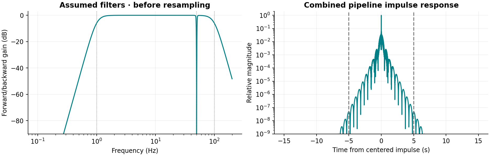
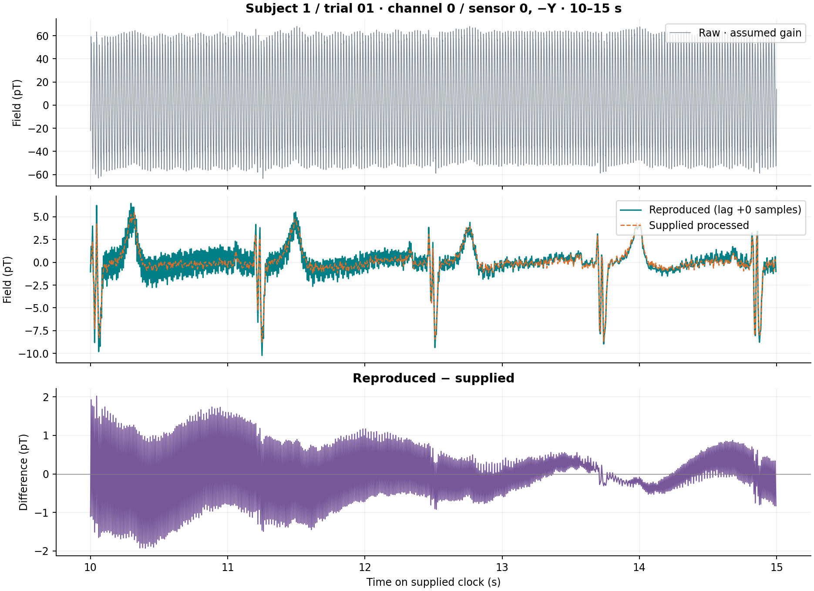
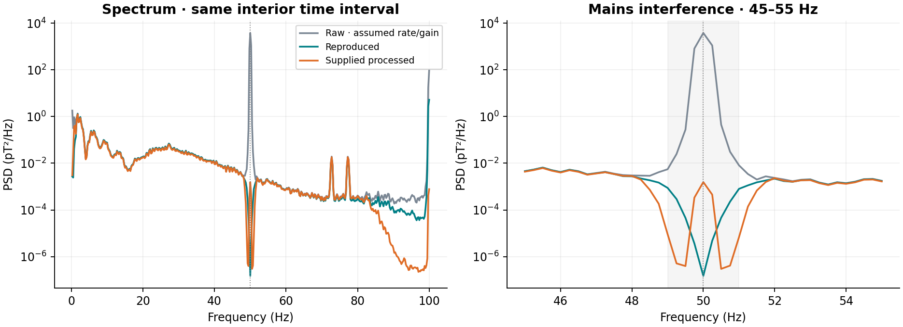

# Kiel MCG Preprocessing
## Reproducing the documented preprocessing of one real magnetocardiography recording

**Technical reproduction report | Version 1 | 30 October 2026**

**Rohail Irfan** | [Project repository](https://github.com/rohailirfan/kiel-mcg-preprocessing)

### Abstract

This project implements the Kiel Cardio Database's documented magnetocardiography (MCG) preprocessing and compares its output with the supplied processed recording. One real pair, subject 1 / trial 01, was selected before calculating agreement. All eight channels were processed. The implementation includes physical scaling, nominal 100 Hz low-pass and 1 Hz high-pass filtering, a band-stop around 50 Hz, and rate conversion. Important original acquisition and processing details are unresolved, so the implementation is explicitly conditional on stated assumptions.

After excluding five seconds at each boundary, channel 0 had Pearson correlation **0.76104** and root mean square error (RMSE) **1.47604 pT** against the supplied signal. Integer-lag checks selected zero offset for every channel. Both outputs strongly suppressed the 49-51 Hz band, but the reproduced spectrum retained substantially more energy near 100 Hz. The result is a partial reproduction of the documented procedure, not an exact match or a clinical validation.

### 1. Objective and scope

The objective was to turn a published preprocessing description into a transparent, executable workflow and test the resulting agreement. Three signals have distinct roles: the original raw voltage recording; the signal calculated by this implementation; and the authors' supplied processed signal, used as a reference output. That reference is not a direct measurement of physiological ground truth.

The source release contains recordings from seven healthy male volunteers, acquired with four dual-axis QuSpin QZFM Gen 1 optically pumped magnetometers in a magnetically shielded chamber [1]. This study uses one volunteer's trial, not a clinical case-control dataset. It does not evaluate ischemia detection, heart-attack prediction, or wearable performance.

### 2. Data selection and provenance

| Item | Selection |
|---|---|
| Source version | Kiel Cardio Database 1.0.0 on PhysioNet |
| Raw record | `subject1_raw_trial01` |
| Supplied reference | `subject1_preprocessed_trial01` |
| Channels | All eight; channel 0 / sensor 0, -Y is the plotted example |
| Original files retained | Four WFDB files and five documentation/metadata files |
| Download volume | 43,175,920 bytes of original files; no full-database download |

The notebook downloads only a fixed allowlist and verifies SHA-256 hashes. The four WFDB files are additionally cross-checked against the preserved upstream checksum list. The original headers and metadata remain unchanged. Dataset attribution and the CC BY-SA 4.0 license are retained [1].

<!-- pagebreak -->

## 3. Input verification and physical interpretation

### 3.1 File decoding, channel pairing and missing samples

Both records use packed 12-bit WFDB format 212 and contain eight matching channel names. Channels 0/1 belong to sensor 0 (-Y/Z); 2/3 to sensor 1 (-Y/Z); 4/5 to sensor 2 (-Y/X); and 6/7 to sensor 3 (-Y/X). The notebook checks names, order, units and header comments rather than assuming that array columns correspond.

WFDB file calibration converts stored integer samples into the units stated in each header [3]:

```text
physical_value = (digital_sample - baseline) / ADC_gain
```

Raw units are volts (V); supplied units are picotesla (pT). A direct digital-to-physical check on a raw segment confirms that this file conversion is applied once. The full raw-channel loop rejects the format-212 missing-sample sentinel, -2048, and the supplied array is checked for finite values. No missing samples were found. Samples at export extrema are counted, but those counts do not establish sensor saturation.

### 3.2 The sampling-rate discrepancy

| Header property | Raw | Supplied processed |
|---|---:|---:|
| Declared sample rate | 200 Hz | 200 Hz |
| Samples per channel | 3,574,784 | 13,964 |
| Duration using declared rate | 17,873.92 s | 69.82 s |
| Rate used in this implementation | 51,200 Hz, assumed | 200 Hz, from header |
| Duration under that interpretation | 69.82 s | 69.82 s |

The sample-count ratio is exactly 256:1. A literal interpretation of the raw header would describe almost five hours, inconsistent with the documented roughly one-minute trials. This implementation therefore **assumes a raw sampling rate of 51,200 Hz**, equal to 256 times the supplied rate. The assumed clock places a strong raw spectral peak at 50 Hz and permits aligned cardiac features after downsampling.

These observations support the interpretation but do not independently verify the acquisition rate: the duration and mains-frequency arguments depend on assumptions about the recording. The original source does not confirm this rate or a factor-256 resampling procedure. No absolute start timestamps are supplied; sample zero is initially treated as the common origin.

### 3.3 Sensor sensitivity is a separate calibration

File decoding produces volts; it does not establish the magnetometer's voltage-to-field sensitivity. QuSpin documents a default analog sensitivity of 2.7 V/nT, with other selectable settings [2]. Because this trial's setting is unconfirmed, the project assumes that default:

```text
B_pT = V * (1000 / 2.7) = V * 370.37037
```

The actual gain could change amplitude agreement and RMSE substantially. Positive constant scaling would not change Pearson correlation. No amplitude multiplier, offset, polarity reversal or time warp was fitted to the reference.

<!-- pagebreak -->

## 4. Preprocessing implementation

The source specifies sensitivity scaling and nominal low-pass, high-pass and band-stop stages [1]. It does not provide the exact filter coefficients, family, orders, stop-band width, phase handling, padding or resampling settings. No original v1.0.0 preprocessing implementation was located in the inspected release and linked sites; this is a scoped search, not proof that no code exists elsewhere.

### 4.1 Declared filter choices

| Stage | Nominal target | This implementation's assumption |
|---|---|---|
| Low-pass | 100 Hz | Butterworth, order 4 |
| High-pass | 1 Hz | Butterworth, order 4 |
| Band-stop | Around 50 Hz | Butterworth, 49-51 Hz; order-2 prototype, fourth-order band-stop |
| Phase / boundary handling | Unspecified | One forward/backward SOS pass, odd reflection; five seconds of padding per end |

All three filters are designed at the assumed raw rate, using second-order sections (SOS) [4]. They are concatenated in source-listed order: low-pass, high-pass, band-stop. One `sosfiltfilt` call processes each full raw channel [5]. At 51,200 Hz, five seconds of padding is 256,000 samples per end. The short display segment is selected only after full-record filtering.

Forward/backward filtering is an offline, zero-phase assumption. It squares the single-pass magnitude response, so the nominal Butterworth low/high cutoffs are approximately -6 dB overall rather than -3 dB. This is not evidence that the original processing used zero phase.

### 4.2 Rate conversion and boundaries

After filtering, `resample_poly` converts the signal from the assumed 51,200 Hz to 200 Hz using up=1, down=256, a Kaiser window with beta=5 and constant boundary padding [6]. Its low-pass antialias filter adds a response near the final Nyquist frequency of 100 Hz. The original rate-conversion method is unknown.

A conventional digital 100 Hz low-pass cannot be designed directly at 200 Hz because the cutoff is at Nyquist. Applying it before rate conversion avoids that design problem under the assumed clock; it does not resolve the source metadata discrepancy.



*Figure 1. Assumed forward/backward filter response before resampling, and the normalized impulse response of the combined filtering/resampling pipeline. Dashed boundaries mark +/-5 s. The peak relative impulse magnitude outside that interval was 4.84 x 10^-8 for this implementation.*

<!-- pagebreak -->

## 5. Alignment and quantitative evaluation

### 5.1 Timing checks

Matching record names do not establish sample-level alignment. The notebook estimates each channel's integer lag over -100 to +100 output samples (+/-0.5 s). A temporary Butterworth 5-30 Hz band-pass with an order-3 prototype (sixth-order single-pass filter), applied forward/backward, emphasizes cardiac waveform structure for lag estimation. These temporary views are not the reproduced output and are not used for the headline RMSE or full-output correlation.

A positive lag L compares `reproduced[i + L]` with `supplied[i]`. The full interior provides the descriptive lag estimate; early (10-30 s) and late (35-55 s) windows check its stability. Every channel selected **zero samples** in all three checks. The approximately 0.99999 correlation in these restricted alignment views must not be substituted for full-output agreement.

### 5.2 Agreement measures and edge exclusion

For reproduced samples x and supplied samples y, the notebook calculates Pearson correlation and root mean square error:

```text
r = covariance(x, y) / (std(x) * std(y))
RMSE = sqrt(sum((x_i - y_i)^2) / N)
```

Correlation measures linear co-variation and is insensitive to constant offsets and positive scaling. RMSE measures physical-amplitude disagreement in pT and responds to timing, scaling, offset and waveform differences. Physical values are retained rather than normalizing the traces.

Both paired sample indices must lie at least five seconds inside their own record boundaries. At zero lag, the scored interval is **5.00 <= t < 64.82 s**, containing **11,964 samples**. Lag estimation and scoring use the same recording, so the results are reference-assisted descriptive agreement, not held-out validation.

### 5.3 Full-output results

| Channel | Sensor / axis | Correlation r | RMSE (pT) | RMSE, 10 s trim (pT) |
|---|---|---:|---:|---:|
| 0 | 0 / -Y | 0.76104 | 1.47604 | 1.36157 |
| 1 | 0 / Z | 0.83611 | 1.67216 | 1.53616 |
| 2 | 1 / -Y | 0.70742 | 1.99140 | 1.85952 |
| 3 | 1 / Z | 0.61692 | 2.38326 | 2.17705 |
| 4 | 2 / -Y | 0.54749 | 2.22823 | 2.13321 |
| 5 | 2 / X | 0.69983 | 2.84987 | 2.64817 |
| 6 | 3 / -Y | 0.74050 | 1.93464 | 1.81604 |
| 7 | 3 / X | 0.77248 | 2.60732 | 2.38554 |

Zero-lag and aligned scores are identical because every estimated lag is zero. Channel 0 therefore has **r = 0.76104** and **RMSE = 1.47604 pT**. Across channels, correlations range from 0.54749 to 0.83611 and RMSE from 1.47604 to 2.84987 pT.

With a stricter ten-second boundary exclusion, channel 0 RMSE is 1.36157 pT. This changes the evaluated data interval as well as the boundary distance; the difference cannot be attributed solely to edge artifacts. The small impulse tail supports the chosen exclusion for this implementation, not the unknown original pipeline.

<!-- pagebreak -->

## 6. Waveform and frequency-domain comparisons



*Figure 2. Channel 0, sensor 0 / -Y, over 10-15 s. Top: raw recording under the assumed clock and sensitivity. Middle: reproduced and supplied outputs. Bottom: reproduced minus supplied. No gain or baseline adjustment was fitted for this comparison.*



*Figure 3. Channel-0 power spectral densities over the same interior interval, with a 45-55 Hz zoom. The spectra agree closely over much of the lower/mid-frequency range but differ in notch shape and near 100 Hz. The supplied spectrum attenuates frequencies above roughly 80 Hz more strongly.*

<!-- pagebreak -->

## 7. Spectral results and interpretation

Welch power spectral density (PSD) estimates use four-second Hann windows, 50% overlap, constant detrending and density scaling [7]. This gives matching 0.25 Hz bins at both sample rates. Raw PSD is computed at the assumed native raw rate, not from an aliased plotting subsample. The spectral interval excludes five seconds at each end. Density units are pT^2/Hz.

Trapezoidal integration of PSD bins from 49 through 51 Hz gives:

| Signal | 49-51 Hz power (pT^2) | Change relative to raw (dB) |
|---|---:|---:|
| Raw, assumed sensitivity | 1426.7618 | 0.00 |
| Reproduced | 0.000365405 | -65.92 |
| Supplied processed | 0.000590783 | -63.83 |

The decibel comparison is `10 * log10(processed_band_power / raw_band_power)`. It demonstrates strong suppression of this frequency band. The band may contain useful signal as well as interference, and stronger suppression alone does not establish better physiological fidelity. The supplied-to-raw comparison also depends on the assumed raw sensitivity.

### 7.1 What agrees and what does not

Cardiac feature timing aligns at the output sampling resolution of 5 ms. Lower/mid-frequency spectral structure is similar, and both outputs strongly reduce the mains band. Nevertheless, full-output correlation is moderate rather than near unity, and the reproduced waveform contains visibly different high-frequency content.

The most prominent spectral mismatch is residual energy near 100 Hz, where the supplied output is much more attenuated. Differences in the original low-pass or decimation response could explain this, and notch shapes also differ. Those are possible explanations, not experimentally established causes. The filter settings were not selected by optimizing the agreement scores.

### 7.2 Limits of the conclusion

- **Acquisition uncertainty:** the raw sampling rate and actual session sensitivity are unconfirmed. A wrong clock would alter every time axis and cutoff interpretation; a wrong sensitivity would alter physical-amplitude agreement.
- **Implementation uncertainty:** exact original filter design, phase, padding and resampling remain unknown. Format-212 quantization and export scaling may also contribute to differences.
- **Evaluation scope:** one healthy volunteer's trial cannot establish performance across the database. Reference-assisted lag estimation is not independent validation, and no physiological ground truth is available here.
- **Clinical scope:** these agreement metrics do not establish clinical accuracy, ischemia detection, heart-attack prediction or wearable validity. A correlation of 0.761 is not 76.1% clinical accuracy.

### 7.3 Conclusion and next steps

The documented preprocessing stages were implemented in a reproducible workflow and evaluated against real supplied data. The result is a **partial reproduction with explicit assumptions**: timing and mains-band suppression agree, while important amplitude/frequency differences remain.

The highest-value next step is obtaining the original acquisition rate, sensitivity setting, filter coefficients, phase/padding and resampling configuration from the dataset authors. Those settings should be verified on this pair before extending the experiment to additional trials. Adjusting undocumented choices only to increase correlation would not establish the original method.

<!-- pagebreak -->

## 8. Reproducibility and verification

The analysis uses Python 3.12.14, NumPy 2.2.6, SciPy 1.15.3, Matplotlib 3.10.3, WFDB 4.3.0 and Pandas 2.2.3. Pandas is pinned because an unpinned Pandas 3 installation caused a WFDB 4.3.0 import failure. The project includes an executable notebook, pinned requirements, original files and metadata, five PNG figures, `metrics.csv`, `results.json` and `data_manifest.json`.

The notebook was executed from start to finish locally. A separate empty-folder run exercised its own downloader and Colab installation branch, reproduced the same results and metrics files, and verified the downloaded originals. A hosted Google Colab runtime was not executed. The report describes those saved results; preparing it did not introduce a new filtering experiment.

To reproduce locally, create a virtual environment, install `requirements.txt`, start JupyterLab in the repository folder, and run `replicate_v1.ipynb` from a fresh kernel. In Colab, upload the notebook and run all cells in a fresh CPU runtime. Missing files are fetched only from the allowlist. Access or checksum errors stop execution; no invented recording or replacement result is generated.

**Analysis baseline:** repository commit [fb694a9](https://github.com/rohailirfan/kiel-mcg-preprocessing/tree/fb694a986d286b699c7ce52188bedfb56e70e529). All numbers in this report are taken from the committed saved run. The detailed execution instructions and full code are in the [project repository](https://github.com/rohailirfan/kiel-mcg-preprocessing).

## References

**[1]** Engelhardt, E., Frey, N., and Schmidt, G. (2023). *Kiel Cardio Database*, version 1.0.0. PhysioNet. [doi:10.13026/q6r2-zz68](https://doi.org/10.13026/q6r2-zz68). [Versioned documentation](https://physionet.org/content/kiel-cardio/1.0.0/), original headers, metadata and release README inspected 30 October 2026.

**[2]** QuSpin. *QZFM Command List*. [Manufacturer documentation](https://quspin.com/products-zf-opm/qzfm-command-list/). Provides selectable analog gains, including the 2.7 V/nT default; it does not establish this trial's setting.

**[3]** WFDB. *Record input/output documentation*. [Official API reference](https://wfdb.readthedocs.io/en/latest/io.html). The current documentation may describe a newer version; the saved analysis used WFDB 4.3.0.

**[4]** SciPy 1.15.3. [`signal.butter`](https://docs.scipy.org/doc/scipy-1.15.3/reference/generated/scipy.signal.butter.html). Butterworth design and SOS representation.

**[5]** SciPy 1.15.3. [`signal.sosfiltfilt`](https://docs.scipy.org/doc/scipy-1.15.3/reference/generated/scipy.signal.sosfiltfilt.html). Forward/backward filtering and boundary padding.

**[6]** SciPy 1.15.3. [`signal.resample_poly`](https://docs.scipy.org/doc/scipy-1.15.3/reference/generated/scipy.signal.resample_poly.html). Polyphase rate conversion with FIR antialias filtering.

**[7]** SciPy 1.15.3. [`signal.welch`](https://docs.scipy.org/doc/scipy-1.15.3/reference/generated/scipy.signal.welch.html). PSD estimation and density scaling.

**[8]** Pollard, T., et al. (2026). *PhysioNet as a global platform for biomedical research*. Nature Health. [doi:10.1038/s44360-026-00096-z](https://doi.org/10.1038/s44360-026-00096-z). Platform citation requested by the dataset page when inspected.

**License and attribution:** Original data: Engelhardt, Frey and Schmidt / PhysioNet, CC BY-SA 4.0. This report and its derived figures are also provided under CC BY-SA 4.0. Original source files are unchanged; the adaptations are the Python reimplementation, conditional scaling, filtering, resampling, plots and agreement calculations. The full license is included in the repository.
